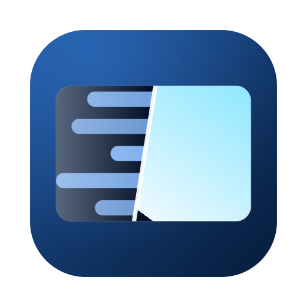
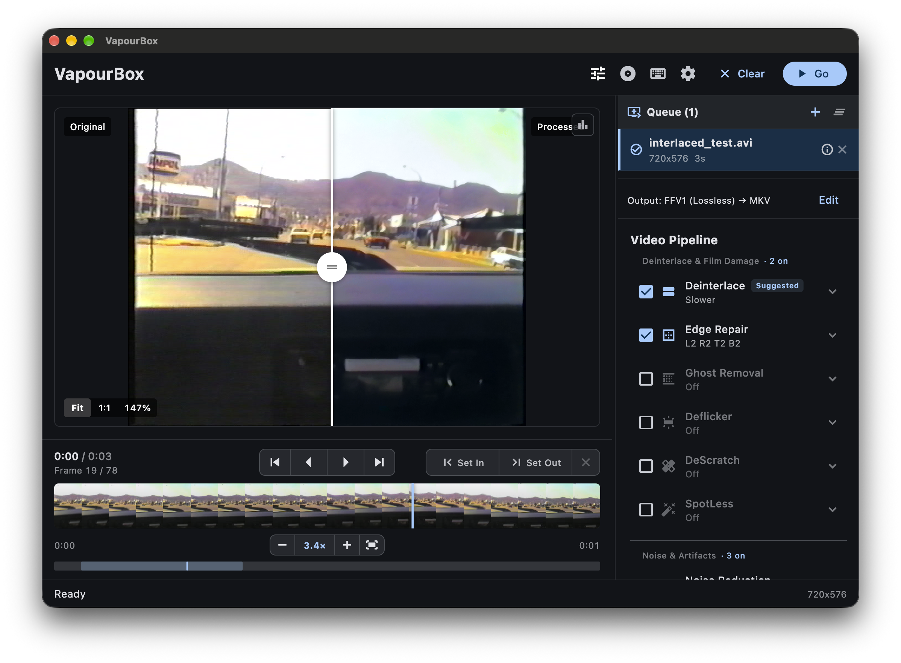

# VapourBox

A desktop app for archiving, converting and restoring video — tape captures, camcorder footage, film scans, DVDs and anime — with the tools the restoration community already trusts, and no scripting.

VapourBox runs [VapourSynth](https://www.vapoursynth.com/), QTGMC and FFmpeg for you: no scripts to write, no plugins to install, no terminal. Everything it needs is downloaded on first launch. It's free, open source, runs on macOS, Windows and Linux, and all processing stays on your machine.

## What it does

- **Converts and archives.** Reads camcorder DV and AVCHD, MPEG-2 from discs and recorders, MXF, and ordinary MP4/MKV/AVI/MOV files, including formats consumer converters mishandle (NTSC DV's 4:1:1 chroma, 10–16-bit film scans). Writes H.264, H.265, ProRes or lossless FFV1, with hardware encoding where available. DVDs and `VIDEO_TS` folders are read directly, and aspect ratio is carried through correctly.
- **Fixes how the picture is stored.** Detects interlaced and telecined sources, then deinterlaces with QTGMC or recovers the original film frames with inverse telecine (or by stripping soft-telecine flags).
- **Cleans up old footage.** Optional filters for tape noise, smeared colour, dust and scratches, flicker, ghosting, compression blocking, banding, camera shake and dark, flat pictures. They're off until you turn them on, and the presets turn on what a given kind of source needs.
- **Restores anime.** **Descale** undoes the upscale most HD anime went through in production, **BM3D** cleans flat colour without smearing lines, and **AI upscaling** redraws line art at 2× or 4×: Real-ESRGAN (sharpest, fastest), Real-CUGAN (gentler, with denoising) or AnimeJaNai (trained on HD anime).
- **Converts frame rates**, with motion interpolation or the **RIFE** AI interpolator.
- **Writes subtitles** from speech with Whisper AI, as an `.srt` file, an embedded track, or burnt into the picture.

## How it works

1. **Add a source.** Drop in a file, a folder, or a `VIDEO_TS` folder, or open a DVD. VapourBox reports what it found (interlaced, telecined or progressive), so you don't have to guess.
2. **Choose the output and any processing.** Pick a format, then start from a preset named after your source (VHS Cleanup, DV Camcorder Tape, Anime DVD, …) or switch filters on yourself. Filters that suit the source are marked **Suggested**.
3. **Check the preview, then run.** A before/after preview updates as you change settings. Queue as many files as you like and leave them to run.

## Download

**[Latest release →](https://github.com/StuartCameronCode/VapourBox/releases/latest)**

| Platform | Minimum OS | File |
|----------|------------|------|
| macOS (Apple Silicon) | macOS 15 Sequoia | `VapourBox-x.x.x-macos-arm64.dmg` |
| macOS (Intel) | macOS 12 Monterey | `VapourBox-x.x.x-macos-x64.dmg` |
| Windows (x64) | Windows 10/11 | `VapourBox-x.x.x-windows-x64-setup.exe` |
| Linux (x64) | glibc 2.39 (Ubuntu 24.04, Debian 13) | `VapourBox-x.x.x-x86_64.AppImage` |
| Linux (arm64) | glibc 2.39 (Ubuntu 24.04, Debian 13) | `VapourBox-x.x.x-aarch64.AppImage` |

There is no account, no telemetry, and nothing is uploaded.

<b>Installing on macOS</b>

1. Download the `.dmg` for your Mac (Apple menu → About This Mac): `arm64` for Apple Silicon, `x64` for Intel.
2. Open it and drag **VapourBox** to Applications.
3. The first launch downloads its processing components (~100 MB).

VapourBox is signed with an Apple Developer ID and notarized, so it opens without Gatekeeper warnings.

<b>Installing on Windows</b>

1. Download the `-setup.exe` installer and run it.
2. The installer isn't code-signed, so SmartScreen may say it "protected your PC". Choose **More info → Run anyway**.
3. Launch VapourBox from the Start menu. The first launch downloads its processing components (~145 MB).

It installs for your user only (`%LOCALAPPDATA%\Programs\VapourBox`), so it never asks for administrator rights. A newer installer upgrades in place; uninstalling from **Settings → Apps** also removes the downloaded components, and leaves your presets alone.

**Portable option:** each release also has a `.zip` of the same build. Extract it anywhere you can write to (e.g. `C:\VapourBox`, not `Program Files`) and run `vapourbox.exe`.

<b>Installing on Linux</b>

1. Download the `.AppImage` for your machine (`x86_64` for Intel/AMD, `aarch64` for ARM).
2. Make it executable: `chmod +x VapourBox-x.x.x-x86_64.AppImage` (or tick *Allow executing file as program* in its Properties).
3. Run it. The AppImage carries its processing components, so it works offline from the first launch.

To get a menu entry and in-place updates, open it with [Gear Lever](https://github.com/mijorus/gearlever), [AppImageLauncher](https://github.com/TheAssassin/AppImageLauncher) or [AppImageUpdate](https://github.com/AppImageCommunity/AppImageUpdate).

Where an AppImage can't be mounted, use the `.tar.gz` of the same build: extract it and run `./vapourbox`. It downloads its processing components (~240 MB) on first launch.

## Hardware and add-ons

**GPU features.** RIFE frame interpolation and AI upscaling run on the graphics card through Vulkan: on any Apple Silicon Mac, and on Windows and Linux x64 PCs with a current graphics driver (RIFE on Windows also needs the Microsoft Visual C++ Redistributable). They aren't available on Intel Macs or Linux on ARM yet. GPU deinterlacing and KNLMeans denoising use OpenCL instead; without it, deinterlacing falls back to the CPU. Whenever you choose a GPU feature your machine can't run, VapourBox says what's missing and how to fix it.

**Add-ons.** A few features use third-party downloads that aren't part of VapourBox: the Whisper engine and language models for subtitles, and the AnimeJaNai models for AI upscaling. VapourBox offers to download one the first time you need it, stating its source, size and licence, and **Settings → Add-ons** installs or removes them at any time. AnimeJaNai is free for **non-commercial use only** (CC BY-NC-SA 4.0); for paid work, use Real-ESRGAN or Real-CUGAN instead.

**Older processors.** Intel and AMD CPUs from before about 2013 (no AVX2) are supported on every platform. VapourBox checks the processor on first launch and installs a matching set of components, which runs some filters more slowly but never differently.

## Output formats

| | |
|---|---|
| **Video** | H.264, H.265, ProRes (Proxy to 4444 XQ), FFV1 (lossless); hardware encoding via VideoToolbox, NVENC, Quick Sync or AMF |
| **Audio** | Passthrough, AAC, Opus or FLAC, or none |
| **Containers** | MKV, MP4, MOV, AVI |
| **Reads** | `.dv` · `.mts` `.m2ts` · `.vob` `.m2v` `.mpg` `.mpeg` · `.mxf` · `.avi` `.mov` `.mp4` `.mkv` `.ts` `.wmv` `.webm` `.flv`, DVD discs and `VIDEO_TS` folders |
| **Source formats** | 4:1:1 (NTSC DV), 4:1:0, 4:2:0/4:2:2/4:4:4 up to 16-bit, RGB, grayscale |
| **Colour format** | Match the source, or convert to 4:2:0 8-bit (plays everywhere), 4:2:0 10-bit (for GPU encoders), 4:2:2 8- or 10-bit, or 4:4:4 10-bit. Matching a 10-bit source makes a 10-bit file, which some players and browsers won't open |
| **Aspect ratio** | Non-square pixels preserved, even through a resize; or convert to square pixels, force a display aspect, or letterbox to a target size |

## The filter pipeline

Most sources need only a few of these, and the presets pick them for you. Filters run in this fixed order, the same order the app lists them in, whichever are switched on.

| # | Filter | What it fixes |
|---|--------|---------------|
| 1 | **Deinterlace** | Combing on motion: QTGMC for interlaced video, IVTC for telecined film, Bwdif for speed |
| 2 | **Edge Repair** | Dirty rows and columns at the edge of a tape capture, rebuilt instead of cropped |
| 3 | **Ghost Removal** | A faint shifted copy of the picture from an aerial or long cable |
| 4 | **Deflicker** | Brightness pulsing between frames, typical of scanned cine film |
| 5 | **DeScratch** | Vertical scratches on scanned film |
| 6 | **SpotLess** | Dust, dirt and single-frame specks |
| 7 | **Descale** | Soft, haloed line art in anime the studio upscaled; **Detect** finds the original resolution |
| 8 | **Noise Reduction** | Grain and video noise. Motion-compensated by default, with BM3D, KNLMeans and more under advanced options |
| 9 | **Chroma Denoise** | Blotchy, smeared colour, common on VHS |
| 10 | **Dehalo** | Bright outlines and ringing around edges |
| 11 | **Deblock** | Blocking from heavy compression |
| 12 | **Deband** | Visible steps in gradients and skies |
| 13 | **Anti-Aliasing** | Stair-stepping on diagonal edges |
| 14 | **Chroma Fixes** | Colour shifted off the picture, bleeding, rainbowing, dot crawl and leftover combing |
| 15 | **Color Correction** | Brightness, contrast, saturation, levels, white balance, shadow detail and local contrast, set by hand or measured |
| 16 | **Stabilize** | Shake and weave from telecine, film scans or a handheld camera |
| 17 | **Rotate / Flip** | Sideways, upside-down or mirrored footage |
| 18 | **Crop & Resize** | Overscan, scaling and upscaling (edge-directed or AI), and borders to reach an exact frame size |
| 19 | **Sharpen** | Soft pictures, sharpened after the resize so the result isn't softened again |
| 20 | **Film Grain** | Grain added back after denoising, so the picture doesn't look plastic |
| 21 | **Frame Rate** | PAL ↔ NTSC and other rate changes, by motion interpolation, RIFE, or frame repetition |
| 22 | **Subtitles** | Speech-to-text with Whisper AI |

The order is designed so each step works on the right picture: damage and noise are removed first, the picture is framed and resized next, and only then sharpened and given grain. The frame rate is converted last, so every other filter works on real frames. Borders are added after everything else, so nothing touches them.

Every filter explains in place what it does and when to use it. Where two filters work against each other — sharpening that brings back halos Dehalo removed, for instance — the app tells you.

## Details

<b>DVDs and folders</b>

**A disc:** click the disc icon in the toolbar, or **Open DVD**. Pick a title from the list (duration, resolution, chapters and audio tracks are shown) and **Add to Queue**; it's extracted, analysed and queued like any other video.

**A ripped disc:** drag in a folder containing `VIDEO_TS`, the `VIDEO_TS` folder itself, or a flat rip (the `VIDEO_TS.IFO` and `.VOB` files directly in a folder). The title picker opens automatically.

**A folder of videos:** drag it in, or use **Open Folder**. It's searched recursively and everything found is queued.

**Encrypted discs.** Most commercial DVDs use CSS encryption. VapourBox doesn't include **libdvdcss** to decrypt them, but uses it if you install it:

- **macOS:** `brew install libdvdcss`
- **Windows:** put `libdvdcss-2.dll` from [VideoLAN](https://www.videolan.org/developers/libdvdcss.html) next to `vapourbox.exe`
- **Linux:** `sudo apt install libdvdcss2` · `sudo dnf install libdvdcss` (RPM Fusion) · `sudo pacman -S libdvdcss`

> CSS decryption may be legally restricted where you live. VapourBox doesn't endorse or support it; libdvdcss is a third-party library that libdvdread loads if it's present.

<b>Preview, timeline and trimming</b>

- **Click** a thumbnail to jump there, or **drag** to scrub. The transport buttons step a frame at a time or jump to either end.
- Zoom the preview with the **mouse wheel** or **pinch**; **double-click** resets it. **1:1** shows actual pixels, the way to judge fine detail, and **Fit** shows the whole frame.
- The **mouse wheel** or **pinch** also zooms the timeline around the cursor, and **Shift+wheel** or a **two-finger swipe** pans it.
- **Set In** / **Set Out** process only part of the source, handy for trying settings on a short section.

<b>Keyboard shortcuts</b>

Every button with a shortcut shows it in its tooltip, and **?** lists them all. Shortcuts without ⌘/Ctrl are ignored while you're typing in a text box.

| Action | macOS | Windows / Linux |
|---|---|---|
| Previous / next frame | ← / → | ← / → |
| Back / forward 10 frames | ⇧← / ⇧→ | Shift+← / Shift+→ |
| Go to start / end | Home / End | Home / End |
| Set in / out point | I / O | I / O |
| Go to in / out point | ⇧I / ⇧O | Shift+I / Shift+O |
| Clear in and out points | ⌥X | Alt+X |
| Preview at actual pixels (1:1) / fit | ⌘1 / ⌘0 | Ctrl+1 / Ctrl+0 |
| Zoom timeline in / out / to fit | = / - / \ | = / - / \ |
| Add videos | ⌘O | Ctrl+O |
| Start processing | ⌘↩ | Ctrl+Enter |
| Settings | ⌘, | Ctrl+, |

<b>Presets</b>

**For Your Source:** VHS Cleanup, DV Camcorder Tape, PAL DVD / Broadcast, DVD IVTC, Anime DVD, 8mm / Super 8 Film Scan and Low-Light Phone / Camera Video. Pick the one that matches what you have.

**Quality Only:** Fast, Balanced and High Quality just deinterlace, with increasing effort, for a picture that's already clean.

Your own presets are saved alongside these, and can be **exported and imported** to share a setup that works for a particular camcorder or capture card. Because a preset can contain custom VapourSynth code and FFmpeg arguments, VapourBox shows you any it contains before importing, and lets you import the preset without them.

<b>Advanced options</b>

By default each filter shows a short, curated set of choices. **Settings → General → Show advanced options** (or the switch beside any filter's settings) reveals every method and parameter, including:

- all 70+ QTGMC parameters, and opt-in higher-precision deinterlacing (4:2:2 chroma, 16-bit processing);
- the less common denoisers: DFTTest, FFT3DFilter, TTempSmooth, FluxSmooth, STPresso, TemporalDegrain2, BM3D, KNLMeans and a large-window median;
- fine control of edge-directed upscaling (NNEDI3's neurons, quality and prescreener; EEDI3's weights);
- Descale's explicit native width and edge handling.

Turning advanced options off never changes what a filter does: a method a preset chose stays selected and visible.

<b>Other settings</b>

All under **Settings → General**:

- **Appearance:** Auto (follows the system), Light, Dark, Monokai or Pride.
- **Temporary Files:** where scratch files go. DVD extraction can need several GB, so move this off a small or slow drive if needed.
- **Existing Output Files:** ask (the default), always overwrite, or always write a new numbered file (`name (2).ext`).

<b>Shutting down after an overnight queue</b>

While a queue runs, tick **Shut down computer when the queue finishes** under the progress bar. When the last video is done, even if some failed, VapourBox counts down for 60 seconds (with **Cancel Shutdown** and **Shut Down Now**), then asks the system to shut down. The option only applies to the run it was ticked for.

A failed video's log is saved first, as `<output name>.error.log` next to where its output would have gone.

The shutdown is never forced, so an app with unsaved work can stop it. VapourBox checks when you tick the option that the shutdown will be allowed:

- **macOS** asks once for permission to control System Events. If you refuse, allow it later in **System Settings → Privacy & Security → Automation**.
- **Linux** needs systemd-logind and an account allowed to power off without a password (normally true for whoever is logged in at the desktop).

## Feedback and bug reports

**Settings → General → "Report a bug or give feedback"** opens the issue tracker. Reports about specific problem sources are especially useful; several fixes came from them.

## Building from source

See [docs/BUILDING.md](docs/BUILDING.md) for build instructions, project structure and the development workflow.

## License

Free software under the [GNU General Public License](LICENSE), version 3 or (at your option) any later version. Full licence texts and third-party attributions are in [licenses/](licenses/).

## Author

Stuart Cameron — [stuart-cameron.com](https://stuart-cameron.com)

## Acknowledgments

VapourBox is a front end to other people's work. Thanks in particular to:

- **QTGMC** by Vit, originally based on TempGaussMC_beta2 by Didée — the deinterlacing algorithm
- **VIVTC** by Fredrik Mellbin — field matching and decimation for inverse telecine
- **VapourSynth** by Fredrik Mellbin — the video processing framework
- **havsfunc**, maintained by HolyWu — the script library QTGMC and many other filters come from
- **MVTools** — the motion estimation QTGMC is built on; VapourSynth port by dubhater, from the AviSynth plugin by Manao with later work by Fizick, Pinterf and the SVP team
- **NNEDI3** by Kevin Stone (tritical) — the edge-directed interpolator behind QTGMC, via **znedi3** by sekrit-twc and dubhater's **nnedi3**, whose NEON kernels make it fast on Apple Silicon and ARM Linux
- **akarin** by Akarin, now maintained by the Jaded Encoding Thaumaturgy project — the expression compiler that makes Apple Silicon and ARM Linux several times faster
- **fmtconv** by Firesledge (Laurent de Soras) — format conversion and resampling
- **zsmooth** by Austin Dworaczyk Wiltshire — chroma denoising (CCD, originally by Sergey Stolyarevsky for VirtualDub) and the RemoveGrain family
- **dubhater** — VapourSynth ports of MVTools, nnedi3, AWarpSharp2, TemporalMedian, FluxSmooth, Bifrost and `adjust`
- **HolyWu** — VapourSynth ports of DFTTest, TTempSmooth, TCanny, CTMF, DCTFilter, Deblock, AddGrain, CAS, EEDI3 and NNEDI3CL
- **mawen1250** — Retinex, BM3D and mvsfunc
- **Edoardo Brunetti** — KNLMeansCL
- **Frechdachs** (maintained by Jaded Encoding Thaumaturgy) — descale
- **vszip** by Julek — CLAHE, the local-contrast lift in Color Correction
- **RIFE** by hzwer (with Megvii) — the frame interpolation network, run through HolyWu's VapourSynth plugin (built on nihui's rife-ncnn-vulkan and Tencent's ncnn), with **MoltenVK** for Vulkan on macOS
- **Real-ESRGAN** by Xintao Wang and **Real-CUGAN** by bilibili — the AI upscaling networks, run through AmusementClub's **vs-mlrt** (VSNCNN)
- **AnimeJaNai** by the-database — anime upscaling models, an optional download (CC BY-NC-SA 4.0, non-commercial use only)
- **whisper.cpp** by the ggml authors and OpenAI's **Whisper** models — speech recognition for subtitles, an optional download
- **libdvdread** by VideoLAN — DVD reading
- **FFmpeg** — encoding and decoding
- **Hybrid** by Selur — the inspiration for this project

Full licence texts, copyright holders and every bundled component are listed in [`licenses/NOTICES.txt`](licenses/NOTICES.txt). If an attribution there is wrong, please [open an issue](https://github.com/StuartCameronCode/VapourBox/issues) and it will be fixed.

<b>Pre-built binary sources</b>

Components taken pre-built rather than compiled from source come unmodified from:

- **[yuygfgg/Macos_vapoursynth_plugins](https://github.com/yuygfgg/Macos_vapoursynth_plugins)** — ARM64 VapourSynth plugins for macOS
- **[Stefan-Olt/vs-plugin-build](https://github.com/Stefan-Olt/vs-plugin-build)** — cross-platform VapourSynth plugins (used for `tmedian`)
- **[evermeet.cx](https://evermeet.cx/ffmpeg/)** — static FFmpeg for Intel Macs
- **[ffmpeg.martin-riedl.de](https://ffmpeg.martin-riedl.de)** — static FFmpeg for Apple Silicon
- **[BtbN/FFmpeg-Builds](https://github.com/BtbN/FFmpeg-Builds)** — static FFmpeg for Windows and Linux
- **[python-build-standalone](https://github.com/astral-sh/python-build-standalone)** — the relocatable Python used on macOS and Linux
- **[Homebrew](https://brew.sh)** — the `whisper-cpp` build used for the macOS subtitle add-on

The Intel Mac build compiles its support libraries from source to run on macOS 12, and is the one build without `akarin`, whose only macOS build needs macOS 14. Intel Macs don't need it: VapourSynth's own expression compiler covers them.

